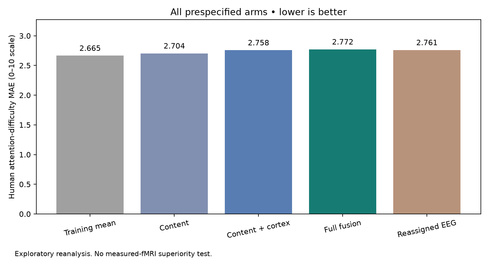
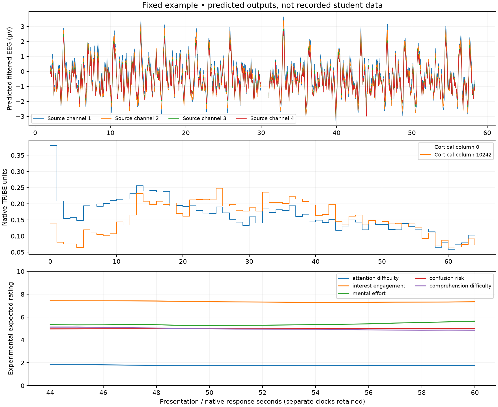

# Numerical brain release: complete results

Lower MAE is better. Human observations and synthetic reviewer agreement are separate endpoints.

| Endpoint | Labels | mean | content_only | content_cortex | full_fusion | reassigned_eeg |
|---|---:|---:|---:|---:|---:|---:|
| attention_difficulty / human | 353 | 2.6654 | 2.7040 | 2.7578 | 2.7721 | 2.7606 |
| attention_difficulty / synthetic | 31 | 1.8178 | 1.7975 | 2.7664 | 2.6927 | 2.6449 |
| interest_engagement / human | Not evaluated | — | — | — | — | — |
| interest_engagement / synthetic | 31 | 0.9961 | 1.3939 | 1.0685 | 1.2262 | 1.1276 |
| mental_effort / human | Not evaluated | — | — | — | — | — |
| mental_effort / synthetic | 31 | 1.1883 | 1.8051 | 1.2142 | 1.2518 | 1.0875 |
| confusion_risk / human | Not evaluated | — | — | — | — | — |
| confusion_risk / synthetic | 31 | 0.9734 | 1.4291 | 1.6352 | 1.7780 | 1.5667 |
| comprehension_difficulty / human | Not evaluated | — | — | — | — | — |
| comprehension_difficulty / synthetic | 31 | 1.0594 | 1.8093 | 1.2629 | 1.3253 | 1.1571 |

Primary comparison: full fusion versus content plus cortex.

MAE reduction: -0.014332; relative reduction: -0.520%.
Descriptive participant/lesson cluster interval: [-0.054876094205585306, 0.028000171306772428].
A negative reduction means the full model performed worse. Four previously evaluated lectures do not provide independent population validation.

The EEG branch remains the frozen speech endpoint. Its existing low correlation is not improved by this integration.
Native TRIBE cortical values are unchanged. Synthetic reviewer agreement is not evidence of student comprehension or engagement accuracy.
The example below is the fixed video qualification fixture; it was not selected using benchmark performance.

